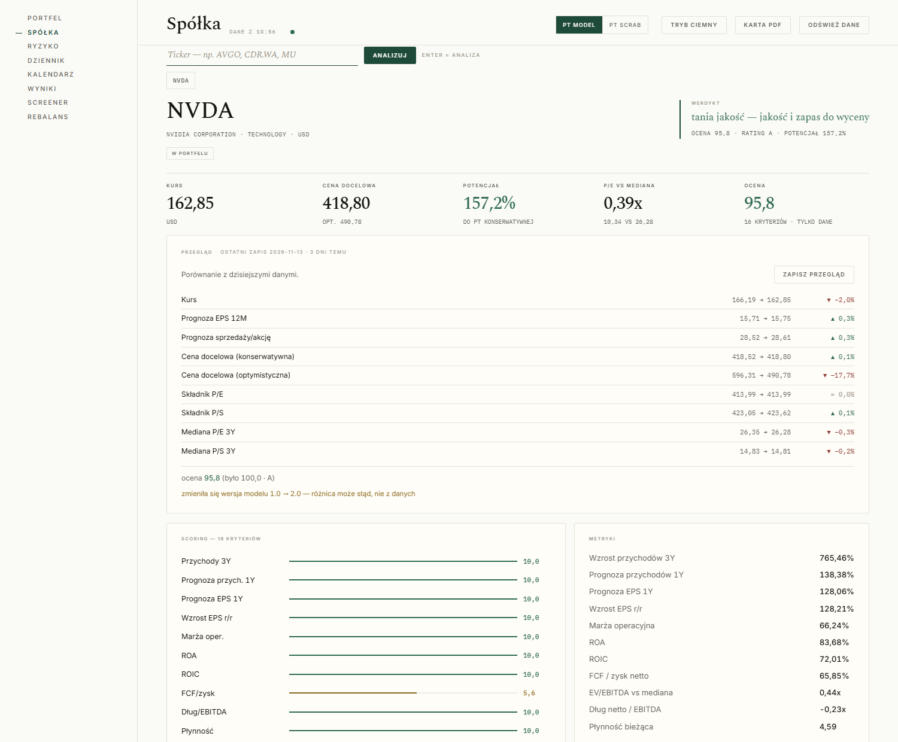
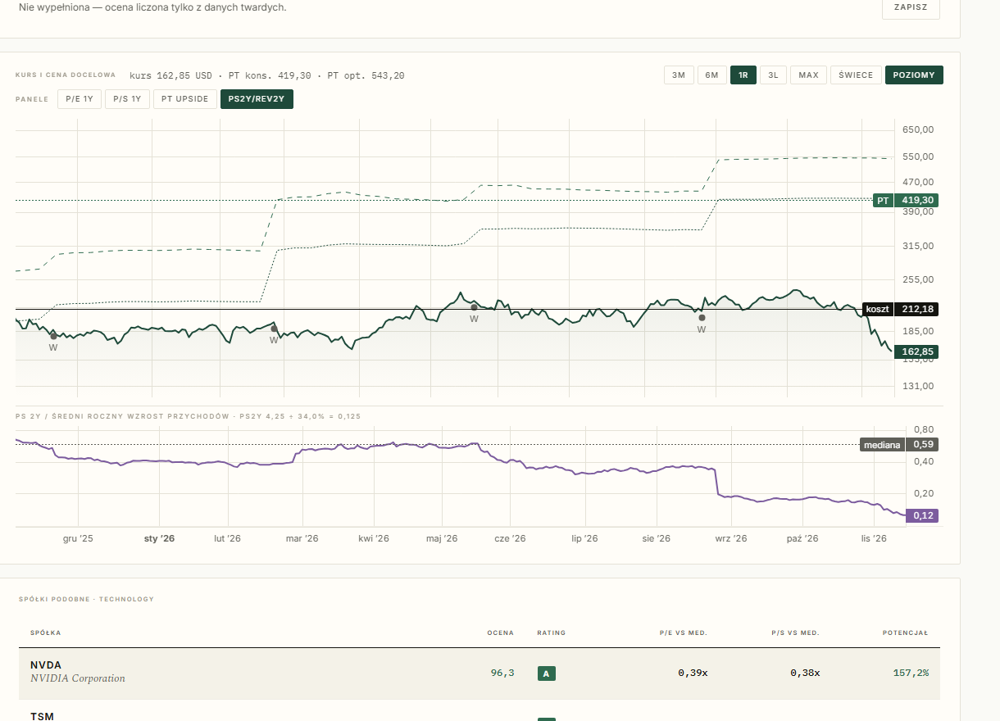

# TFAL Terminal

A local equity-research terminal for a single investor: valuation, quality scoring, portfolio
accounting and reporting — running as a desktop app on your own machine and data files.



> **90-second demo:** [`demo.mp4`](demo.mp4) — portfolio, the company card, scoring, estimate revisions,
> the chart, the journal, performance, risk and rebalancing, recorded on anonymised sample data.
>
> **Recruiter / reviewer?** Start with [`PRZEWODNIK-po-projekcie.docx`](PRZEWODNIK-po-projekcie.docx) —
> a 7-page guide (in Polish) covering what the app does, a walkthrough of every screen, how the
> numbers are computed, how to run it and what it does not do.

## Why it exists

Spreadsheet valuation works until you want to answer the same questions every week: *what is this
company worth at its own historical multiples, how does it score on fundamentals, what did my
portfolio actually earn, and how much of that was the stock versus the currency?* This project
turns that manual routine into a reproducible tool.

The valuation method follows the approach I use for my own portfolio: target price from historical
P/E, P/S and EV/EBITDA multiples (3-year window) applied to 12-month forward estimates, plus a
16-criterion quality score computed from the same data.

## What it does

**Valuation** — conservative and optimistic target price (median and median-of-yearly-highs
multiples × forward EPS / revenue per share), sensitivity grids, an inverted "what the price
assumes" calculator, and a custom PS 2Y / revenue-growth ratio.

**Quality score** — 16 criteria across growth, balance sheet, capital returns (ROIC), cash
conversion (FCF/net income), valuation vs own history (P/E, P/S, EV/EBITDA) and estimate
revisions (target price and EPS). Thresholds are interpolated instead of stepped; missing data
renormalises weights instead of scoring zero.

**Portfolio accounting** — FIFO cost basis in the instrument currency, P&L converted at the
transaction-date FX rate (not today's), TWR and MWR (XIRR), drawdown, monthly returns, benchmark
comparison (S&P 500, Nasdaq 100, MSCI World, WIG20TR), attribution per holding, and journal
statistics: hit rate, average holding period, what the price did 60 days after each sale.

**Risk** — annualised volatility, VaR (parametric and historical), correlation matrix, risk
contribution, concentration (HHI), simple stress scenarios.

**Reporting** — three-page company card PDF, portfolio/rebalance exports, and a 31-page
documentation PDF generated from Markdown.

## Architecture

```
app.py            Flask API (28 endpoints) + view models
scoring.py        quality score, criteria weights, metric normalisation
tfl.py            data-driven checklist (trend, revisions, forward ratios)
scrab_client.py   FactSet data via the Scrab API (session cookie, cached bundles)
perf.py           benchmark series, relative metrics, FX history (NBP)
wyniki.py         TWR/MWR engine over the transaction journal
rebalans.py       target weights, position/sector caps, order list
karta.py          company card PDF (matplotlib)
web/              single-page frontend: HTML + CSS + Lightweight Charts, no framework
desktop.py        frameless WebView2 window (pywebview), single-instance mutex
```

Data comes from three sources: FactSet fundamentals through the Scrab API, quotes and corporate
events from Yahoo Finance, FX rates from the NBP API. Everything is cached on disk; the app works
offline once the data is fetched.

`pt.py`, `batch.py` and `analiza.py` are the original command-line prototypes (single-company
valuation, portfolio scoring, the first Excel export). They still run, but the app supersedes them
and they are kept to show how the model evolved.

## Running it

Requires Windows 10/11 with WebView2 (ships with Edge) and Python 3.12.

```bash
python -m venv venv
venv\Scripts\pip install -r requirements.txt
```

Then double-click `Terminal.bat` (or `venv\Scripts\pythonw.exe terminal.py`).

On first run the app creates its own state files. **The repository contains no data and no
credentials** — market data needs a Scrab session (`scrab_session.json`, exported cookies from a
logged-in browser), which is not included and must not be committed.

## Design notes

The interface is deliberately paper-like: light background, serif headings, monospaced numbers, no
cards with shadows. Only the price chart uses a logarithmic scale — multiple panels stay linear,
because you read a level there, not a percentage change.



## Documentation

- [`docs/MODEL.md`](docs/MODEL.md) — every formula: valuation, scoring, risk, performance
- [`docs/ARCHITEKTURA.md`](docs/ARCHITECTURA.md) — modules, data flow, files
- [`docs/API.md`](docs/API.md) — endpoints and payloads
- [`docs/OPERACJE.md`](docs/OPERACJE.md) — running, troubleshooting, limitations
- [`docs/Dokumentacja-TFAL.pdf`](docs/Dokumentacja-TFAL.pdf) — printable 31-page version
- [`PRZEWODNIK-po-projekcie.docx`](PRZEWODNIK-po-projekcie.docx) — 7-page guide for reviewers
  ([PDF](docs/PRZEWODNIK-po-projekcie.pdf))

## Status and next steps

Personal project, under active development. Known gaps: no tax reporting (PIT-38), journal does not
handle stock splits, and the date range selector on the results view only affects charts, not KPIs.

## Disclaimer

Educational project, not investment advice. Market data belongs to its providers (FactSet/Scrab,
Yahoo Finance, NBP) and is not redistributed here. The code is published for portfolio review.

**Kacper Teichert** · [github.com/kicporr](https://github.com/kicporr) · kacper.teichert6790@gmail.com
