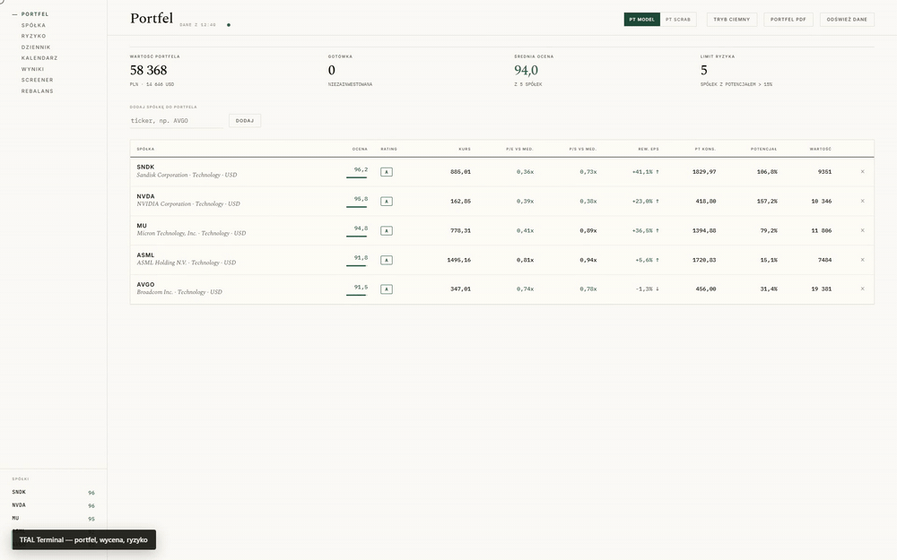
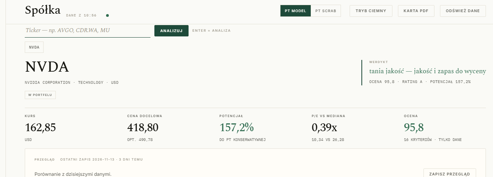

# TFAL Terminal

**A desktop equity-research terminal for a single investor.** It values a company at its own
historical multiples, scores it on 16 criteria, keeps a FIFO journal with FX at trade date and
reports what the portfolio actually earned — all locally, on your own files.

[](https://github.com/kicporr/tfal-terminal/actions/workflows/ci.yml)
[](LICENSE)
[](requirements.txt)
[](#quick-start)



*90-second walkthrough — [demo.mp4](demo.mp4) (recorded on anonymised sample data).*

## Why it exists

Spreadsheet valuation works until you want to answer the same questions every week: *what is this
company worth at its own multiples, how does it score on fundamentals, what did my portfolio earn,
and how much of that was the stock versus the currency?* This project turns that manual routine into
a reproducible tool with one source of truth: the numbers on screen and the numbers in the PDF come
from the same calculation.

## Features

| Area | What it does |
|---|---|
| **Valuation** | Target price from 3-year P/E, P/S and EV/EBITDA multiples applied to 12-month forward estimates; conservative (median) and optimistic (median of yearly highs) scenarios; sensitivity grids; inverted "what the price assumes" calculator; custom PS 2Y / revenue-growth ratio |
| **Quality score** | 16 criteria across growth, balance sheet, capital returns (ROIC), cash conversion (FCF/net income), relative valuation and estimate revisions; interpolated thresholds; weights renormalise on missing data |
| **Portfolio** | FIFO cost basis in the instrument currency, P&L converted at the **transaction-date** FX rate, position weights, watchlist, source switch between model and consensus target price |
| **Journal** | Manual entry or XTB import with duplicate detection; per-ticker hit rate, holding period and price 60 days after a sale |
| **Performance** | TWR and MWR (XIRR), drawdown, monthly returns, benchmark comparison (S&P 500, Nasdaq 100, MSCI World, WIG20TR) with beta, alpha, tracking error and up/down capture; attribution including cash and FX |
| **Risk** | Annualised volatility, parametric and historical VaR, correlation matrix, risk contribution, HHI concentration, stress scenarios |
| **Reporting** | Three-page company card PDF, portfolio and rebalance exports, 31-page documentation PDF generated from Markdown |
| **Shell** | Frameless WebView2 window with its own title bar, single-instance guard, light and dark themes, logs to `TFAL-log.txt` |

## Screenshots

| Company card | Chart panels |
|---|---|
|  |  |

## Quick start

Requires **Windows 10/11** (WebView2 ships with Edge) and **Python 3.12**.

```bash
python -m venv venv
venv\Scripts\pip install -r requirements.txt
```

Then double-click `Terminal.bat` (or `venv\Scripts\pythonw.exe terminal.py`). The app creates its
own state files on first run and listens on `http://127.0.0.1:8765`.

## Data and privacy

Market data comes from three sources: **FactSet** fundamentals through the Scrab API, **Yahoo
Finance** for quotes and corporate events, and the **NBP** (Polish central bank) for FX rates.
Everything is cached on disk, so the app keeps working offline once data is fetched.

The repository contains **no market data, no credentials and no portfolio records**. Fetching new
data needs your own Scrab session (`scrab_session.json`, cookies exported from a logged-in browser);
without it the app starts and shows a message instead of data. Files that hold personal data —
`state.json`, `journal.json`, `checklist.json`, `_cache/` — are listed in `.gitignore` and must never
be committed.

## Architecture

```
app.py            Flask API (28 endpoints) and view models
scoring.py        quality score, criteria weights, metric normalisation
tfl.py            data-driven checklist: trend, revisions, forward ratios
scrab_client.py   FactSet data through the Scrab API: session, cache, multiples
perf.py           benchmark series, relative metrics, NBP FX history
wyniki.py         TWR/MWR engine over the transaction journal
rebalans.py       target weights, position and sector caps, order list
karta.py          company card PDF (matplotlib)
web/              single-page frontend: HTML, CSS, bundled fonts, Lightweight Charts
desktop.py        frameless WebView2 window (pywebview), single-instance mutex
```

`pt.py`, `batch.py` and `analiza.py` are the original command-line prototypes (single-company
valuation, portfolio scoring, the first Excel export). They still run, but the app supersedes them;
they are kept to show how the model evolved.

## Documentation

- [docs/PRZEWODNIK-po-projekcie.pdf](docs/PRZEWODNIK-po-projekcie.pdf) — 7-page guide for reviewers (Polish): every screen, the method, how to run it
- [docs/MODEL.md](docs/MODEL.md) — every formula: valuation, scoring, risk, performance
- [docs/ARCHITEKTURA.md](docs/ARCHITEKTURA.md) — modules, data flow, files on disk
- [docs/API.md](docs/API.md) — endpoints and payloads
- [docs/DANE.md](docs/DANE.md) — data sources, metric keys, caching
- [docs/OPERACJE.md](docs/OPERACJE.md) — running, troubleshooting, limitations
- [docs/Dokumentacja-TFAL.pdf](docs/Dokumentacja-TFAL.pdf) — the same documents as a printable 31-page PDF

## Limitations

Named openly, because a model you cannot audit is a model you cannot trust:

- no tax reporting (PIT-38, Polish withholding); portfolio results are gross,
- the journal does not handle stock splits — transactions must be corrected after a split,
- the date-range selector on the results view changes the charts, not the KPIs,
- daily data only (close prices); this is not an intraday terminal,
- single-user and local: no login, no cloud, no multi-device sync,
- fetching new data requires a paid Scrab/FactSet subscription.

## License

Code under the [MIT license](LICENSE). Bundled fonts and libraries keep their own licences — see
[THIRD-PARTY.md](THIRD-PARTY.md). Market data is not redistributed.

---

**Kacper Teichert** · [github.com/kicporr](https://github.com/kicporr) · kacper.teichert6790@gmail.com
